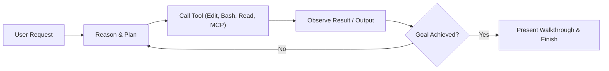

# Mastering Antigravity (Agy): The Complete Developer Guide

[](https://github.com/bceenaeiklmr/learn_AGY)
[](https://opensource.org/licenses/MIT)
[](https://www.python.org/)
[](https://www.autohotkey.com/)

Welcome to your Antigravity (Agy) sandbox and reference workspace! This repository is hosted at [github.com/bceenaeiklmr/learn_AGY](https://github.com/bceenaeiklmr/learn_AGY) and comes pre-configured with workspace rules, custom skills, lifecycle hooks, and an MCP configuration tailored to **Python** and **AutoHotkey (AHK v2)** on Windows.

### Quick Clone
```bash
git clone https://github.com/bceenaeiklmr/learn_AGY.git
cd learn_AGY
```

---

## Table of Contents
1. [The Core Mental Model](#1-the-core-mental-model)
2. [Context Budget & Progressive Disclosure](#2-context-budget--progressive-disclosure)
3. [The 4 Customization Mechanisms (Rules, Skills, Hooks, MCP)](#3-the-4-customization-mechanisms)
4. [Mastering Slash Commands](#4-mastering-slash-commands)
5. [Subagents & Parallel Execution](#5-subagents--parallel-execution)
6. [Your Pre-configured Sandbox Tools](#6-your-pre-configured-sandbox-tools)
7. [Hands-On Practice Drills](#7-hands-on-practice-drills)

---

## 1. The Core Mental Model

Most developers treat LLMs as interactive chatbots: they copy-paste snippets back and forth. 

**Antigravity is fundamentally different: it is an Agentic Pair Programmer.**
Instead of just predicting the next sentence, Agy operates in a continuous **ReAct (Reason + Act) loop**:



### The 3 Laws of High-Leverage Agentic Coding
1. **Goal-Driven Execution**: Give Agy explicit success criteria (e.g. *"Run pytest and ensure all 5 tests pass"*). When success is measurable, Agy can self-correct in a loop without requiring your manual intervention.
2. **Context Hygiene**: The agent's reasoning quality degrades when the context window is cluttered with irrelevant logs or massive files. Keep context clean by delegating to subagents and using targeted file reads.
3. **Deterministic Guardrails**: Don't rely on the model to "remember" not to break formatting or delete files. Use **Rules**, **Hooks**, and **Skills** to enforce constraints deterministically.

---

## 2. Context Budget & Progressive Disclosure

Every conversation turn with an LLM sends a payload consisting of:
- The agent's base system prompt and tool definitions
- Active rules
- Skill names and descriptions
- Conversation transcript history

### The Rule & Skill Budget
- **Rules Budget**: Always-on rules share a dedicated **20,000-token budget**. If rules exceed this limit, they are demoted to file-path pointers that the agent must view on demand.
- **Progressive Disclosure**: Agy does **not** load the full text of all your skills at startup. It only injects the YAML frontmatter (`name` and `description`). Only when a task matches the skill's purpose does Agy open and read the full `SKILL.md` and its `references/`.

> [!TIP]
> Keep your `SKILL.md` frontmatter description precise and focused on **when** and **what** it does. Keep the body concise, and move bulky documentation into `references/` files.

---

## 3. The 4 Customization Mechanisms

Choose the right tool for the job:

| Customization | Location | Active When | Best For |
| :--- | :--- | :--- | :--- |
| **Rules** | `.agents/rules/AGENTS.md` | **Always** | Project-wide constraints, coding style, architectural boundaries, forbidden patterns. |
| **Skills** | `.agents/skills/<name>/SKILL.md` | **On Demand** | Step-by-step runbooks, multi-step workflows, complex debugging procedures. |
| **Hooks** | `.agents/hooks.json` | **Lifecycle Events** | Deterministic scripts that run before/after tools (`PreToolUse`, `PostToolUse`, `Stop`). |
| **MCP** | `mcp_config.json` | **Tool Calls** | Connecting external data, APIs, databases, or custom Python CLI tools. |

---

## 4. Mastering Slash Commands

Slash commands are high-leverage workflows built into the chat canvas:

- **`/plan`**: *(What we used to start this!)* Forces architectural thinking, research, and an implementation plan artifact before any code is modified.
- **`/goal`**: Puts Agy in deep autonomous mode. Use this for overnight or long tasks where you want the agent to exhaustively loop and verify before stopping.
- **`/grill-me`**: Launches an interactive interview where Agy tests your architectural assumptions, surfaces trade-offs, and resolves ambiguities before building.
- **`/boost`**: Activates multi-perspective reasoning for tough architectural bugs or complex refactors.
- **`/schedule`**: Sets background timers or recurring cron schedules (e.g. checking a deployment or test suite).
- **`/learn`**: Tells Agy to capture a correction or preference so it remembers it across future sessions.

---

## 5. Subagents & Parallel Execution

When you ask an agent to research a large library or inspect 50 log files, loading all of that into your primary conversation floods your context.

**Subagents solve this problem:**
- **`research`**: A read-only subagent that navigates the web and reads files, then returns only a distilled summary back to the parent.
- **`self`**: A subagent with full tool capabilities running in an isolated sub-thread.

**When to use subagents:**
1. Broad codebase exploration.
2. Long-running tasks that run asynchronously in the background while you keep chatting with the main agent.
3. Complex, multi-branch refactoring where each branch is explored in isolation.

---

## 6. Your Pre-configured Sandbox Tools

This repository contains pre-built examples ready for experimentation:

### 1. Workspace Rules: [.agents/rules/AGENTS.md](file:///C:/dev/projects/learn_agy/.agents/rules/AGENTS.md)
Enforces:
- Python 3.10+ PEP 8 standards, typing, and pytest conventions.
- AutoHotkey v2 syntax standards (no legacy v1 `%var%`), emergency kill switches (`^Esc`), and single-instance enforcement.

### 2. AutoHotkey v2 Skill: [.agents/skills/ahk-workflow/SKILL.md](file:///C:/dev/projects/learn_agy/.agents/skills/ahk-workflow/SKILL.md)
- Contains step-by-step procedures for writing safe, performant Windows automation.
- Links to [references/syntax.md](file:///C:/dev/projects/learn_agy/.agents/skills/ahk-workflow/references/syntax.md) demonstrating progressive disclosure.

### 3. Python TDD Skill: [.agents/skills/python-tdd/SKILL.md](file:///C:/dev/projects/learn_agy/.agents/skills/python-tdd/SKILL.md)
- Guides Red-Green-Refactor cycles.
- Includes an automated test runner script in [scripts/test_runner.py](file:///C:/dev/projects/learn_agy/.agents/skills/python-tdd/scripts/test_runner.py).

### 4. Lifecycle Hooks: [.agents/hooks.json](file:///C:/dev/projects/learn_agy/.agents/hooks.json)
- `PreToolUse`: Safety gate that inspects shell commands before execution and blocks destructive commands.
- `PostToolUse`: Fires after file modifications to remind or check code validity.

### 5. MCP Server Starter: [examples/demo_mcp/local_mcp_server.py](file:///C:/dev/projects/learn_agy/examples/demo_mcp/local_mcp_server.py)
- A standalone, pure Python script implementing JSON-RPC 2.0 stdio communication. Shows exactly how MCP exposes tools like `calculate_hash` to Agy.

---

## 7. Hands-On Practice Drills

Try these prompts right now in this conversation to see how Agy leverages your setup:

### Drill A: Testing Workspace Rules (AutoHotkey)
> **Prompt to try:**  
> *"Create an AutoHotkey script that switches between Chrome and VS Code using Alt+Q."*  
> **What to observe:**  
> Watch Agy automatically apply your `.agents/rules/AGENTS.md` rules: using strict AHK v2 syntax, adding `#Requires AutoHotkey v2.0+`, `#SingleInstance Force`, and an emergency `^Esc::ExitApp()` kill switch without being asked!

### Drill B: Testing the Python TDD Skill
> **Prompt to try:**  
> *"Use the python-tdd skill to add an `is_palindrome` function to `examples/demo_python/app.py`."*  
> **What to observe:**  
> Watch Agy activate the `python-tdd` skill, write the test in `test_app.py` first, run `test_runner.py` to see it fail, then implement the minimal solution and verify it passes.

### Drill C: Testing `/grill-me`
> **Prompt to try:**  
> *"/grill-me I want to build a desktop hotkey manager in Python with system tray support."*  
> **What to observe:**  
> Instead of immediately writing code, Agy will launch an interactive interview with targeted questions about UI libraries, persistence, and operating system quirks.
